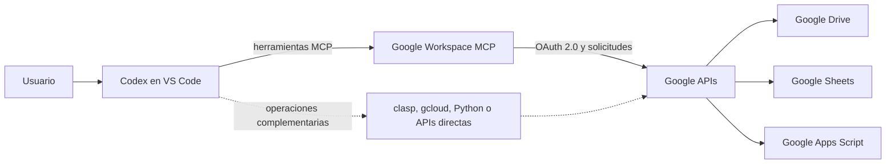

# Codex + Google Workspace mediante MCP

Prueba de concepto de integración de **OpenAI Codex en Visual Studio Code** con Google Sheets, Google Apps Script y Google Drive. El foco de este repositorio es la conexión entre el asistente y los servicios de Google, no el desarrollo del CRM utilizado como entorno de prueba.

## Alcance y contribución

Investigué, instalé, configuré y validé el servidor de terceros [Google Workspace MCP, de taylorwilsdon](https://github.com/taylorwilsdon/google_workspace_mcp). **No desarrollé ese servidor.** Preparé el proyecto de Google Cloud y OAuth 2.0, registré el servidor en Codex y habilité servicios de forma progresiva. Comprobé lecturas de Sheets y Apps Script mediante MCP. También realicé modificaciones en Sheets y Apps Script, accedí a archivos de Drive, creé carpetas y copié el CRM a una carpeta de destino. Para estas últimas operaciones, el registro disponible no identifica siempre la herramienta de ejecución.

Usé herramientas complementarias como `clasp`, `gcloud` y APIs de Google durante la experiencia. Sus acciones no se atribuyen al servidor MCP cuando la evidencia no permite hacerlo. Los nombres, identificadores y datos privados de los recursos utilizados no se publican aquí.

## Tecnologías

Visual Studio Code, OpenAI Codex, Model Context Protocol (MCP), Google Workspace MCP, Google Cloud Console, OAuth 2.0, Google Drive API, Google Sheets API, Google Apps Script API y `uv`. `gcloud` y `clasp` se utilizaron como herramientas complementarias; Python y APIs directas también formaron parte del trabajo con archivos de prueba. Cada componente tuvo un papel distinto.

## Arquitectura

La ruta punteada representa herramientas externas al servidor MCP. El diagrama muestra opciones de acceso; no implica que toda operación se haya ejecutado por ambas rutas.

## Instalación y configuración, en resumen

1. Preparé un proyecto en Google Cloud, habilité las APIs de Sheets, Apps Script y Drive, y configuré una aplicación OAuth de escritorio con audiencia externa y usuario de prueba.
2. Habilité además el acceso a la Apps Script API desde la configuración de usuario de Apps Script.
3. Instalé Google Workspace MCP en un entorno aislado de `uv`, registré su transporte `stdio` en Codex y autoricé la cuenta de prueba mediante el flujo OAuth.
4. Recargué VS Code y abrí una conversación nueva para descubrir las herramientas. La validación local inicial encontró 27 herramientas de Sheets y Apps Script.
5. Amplié después el servidor con Drive, limitado a búsqueda, listado y copia. La validación local posterior encontró 30 herramientas en total.

La guía técnica y los puntos cuyo comando exacto no quedó registrado están en [docs/instalacion.md](docs/instalacion.md). [examples/config.toml.example](examples/config.toml.example) contiene un ejemplo ficticio basado en parámetros observados localmente.

## Etapas de integración

### Google Sheets

La primera etapa permitió acceder a un spreadsheet vinculado a un proyecto de Apps Script y leer su estructura mediante MCP. También se comprobó una consulta de estructura mediante solicitudes GET de Sheets API. El entorno de aplicación fue un CRM previamente desarrollado, con hojas utilizadas como base de datos y para ingreso de información, más un sistema de gestión para consultas y operaciones diarias. También leí y modifiqué información de Sheets durante la integración. La lectura de estructura mediante MCP está respaldada por la validación local; la modificación fue verificada en la experiencia, pero la herramienta de ejecución no está identificada con certeza.

### Google Apps Script

Mediante MCP se leyó el proyecto asociado al CRM, incluidos sus archivos de código, HTML y manifiesto, y se confirmó la lectura completa de un archivo fuente. Esto permitió a Codex analizar funciones y la relación entre código y hojas. También se configuró `clasp` con autenticación de Google para trabajo complementario. En una operación inicial de `clasp` apareció un mensaje de que no se encontraban archivos de script; ese mensaje no impidió el acceso posterior confirmado mediante MCP. También modifiqué código de Apps Script y comprobé el resultado. La lectura mediante MCP está respaldada por la validación local; para la edición, operación verificada; herramienta de ejecución no identificada con certeza. Por ello, la edición no se atribuye específicamente a MCP ni a `clasp`.

### Google Drive

Durante la integración accedí a archivos de Drive, creé carpetas y copié el CRM a una carpeta de destino para pruebas (aquí, **Carpeta de pruebas**). Son operaciones verificadas; herramienta de ejecución no identificada con certeza en el registro disponible. La configuración local examinada del servidor MCP habilitó búsqueda, listado y copia, y deshabilitó la creación de carpetas mediante ese servidor. Su validación local confirmó el inventario de herramientas, sin ejecutar la copia en esa sesión de configuración. Por eso, la creación de carpetas no se atribuye a esa configuración MCP. Buscar o consultar, modificar contenido, copiar y administrar carpetas requieren capacidades y permisos distintos.

## Pruebas y resultados

| Área | Operación | Estado y vía |
| --- | --- | --- |
| Codex | Descubrimiento y selección de herramientas MCP desde la conversación | **Comprobado:** inventario local de 27 herramientas iniciales y 30 tras añadir Drive. |
| Sheets | Lectura de estructura del spreadsheet vinculado | **Comprobado:** MCP; también hubo consultas GET con Sheets API directa. |
| Sheets | Lectura y modificación de información | **Verificadas por el autor.** Lectura de estructura mediante MCP y GET de Sheets API documentadas; para la modificación, operación verificada; herramienta de ejecución no identificada con certeza. |
| Apps Script | Acceso al proyecto, archivos y lectura completa de fuente | **Comprobado mediante MCP.** |
| Apps Script | Análisis de funciones y vínculo con Sheets | **Comprobado como uso de lectura y análisis**; la identificación del spreadsheet vinculado incluyó una consulta directa de metadatos de Script API. |
| Apps Script | Edición de código | **Operación verificada; herramienta de ejecución no identificada con certeza.** No se atribuye exclusivamente a MCP ni a `clasp`. |
| Drive | Acceso a archivos | **Operación verificada; herramienta de ejecución no identificada con certeza.** Búsqueda y listado estaban disponibles en la configuración MCP examinada. |
| Drive | Copia del CRM a Carpeta de pruebas | **Operación verificada; herramienta de ejecución no identificada con certeza.** La validación local de la herramienta MCP no fue la ejecución de esa copia. |
| Drive | Creación de carpetas | **Operación verificada; herramienta de ejecución no identificada con certeza.** La creación estaba deshabilitada en la configuración MCP examinada. |
| Herramientas complementarias | `clasp`, `gcloud`, Python y APIs directas | **Fuera de MCP.** La autenticación de `clasp` y las lecturas directas de APIs constan en las notas; no se atribuyen a MCP sus posibles cambios. |

Los resultados combinan la validación local documentada y la confirmación del autor sobre operaciones completadas durante la integración. Cuando falta trazabilidad por herramienta, se indica expresamente. No representan una prueba de todas las capacidades del servidor de terceros.

## Problemas y límites

La configuración de OAuth exigió distinguir el proyecto de Cloud, las APIs habilitadas, la pantalla de consentimiento, los usuarios de prueba y los permisos solicitados. Durante el proceso apareció un error 403 vinculado al acceso de una aplicación en modo de prueba; la configuración de audiencia y usuario de prueba permitió continuar hasta las lecturas autenticadas. No se conserva aquí una secuencia técnica más detallada de ese incidente. El modo de prueba puede requerir renovar la autorización.

Apps Script requirió tanto la API habilitada en Cloud como el ajuste correspondiente en la cuenta de usuario. El alcance de `clasp` y el de MCP son distintos. Las herramientas disponibles no equivalen a operaciones completadas, y las APIs de Drive, Sheets y Script exigen permisos diferentes. La validación local de lectura no ejecutó funciones de Apps Script ni escrituras remotas; las modificaciones y operaciones de Drive confirmadas ocurrieron durante la experiencia de integración, fuera de esa validación concreta.

En un entorno empresarial harían falta permisos mínimos por rol, control y revisión de cambios, protección de datos, auditoría y confirmación de operaciones sensibles. Esta prueba de concepto no es un despliegue productivo.

## Aplicaciones empresariales

Una integración de este tipo puede ayudar a automatizar tareas frecuentes mediante lenguaje natural, consultar y actualizar registros en Sheets, analizar aplicaciones internas de Apps Script, localizar y organizar documentos en Drive y conectar asistentes especializados con otros sistemas mediante una arquitectura modular. Cada acción debe pasar por herramientas autorizadas y controles acordes con su impacto.

**Caso ilustrativo ficticio:** una empresa guarda datos operativos en Sheets, automatiza procesos con Apps Script y organiza documentos en Drive. Un empleado pide a Codex que consulte registros, señale inconsistencias, prepare cambios para revisión y organice copias de trabajo. Las acciones se ejecutan únicamente con permisos adecuados y aprobación de cambios sensibles. Este escenario muestra una posibilidad empresarial, no una solución productiva implementada ni una mejora de productividad medida.

## Conclusión

La prueba de concepto demostró que Codex puede descubrir herramientas MCP y leer estructuras de Sheets y código de Apps Script asociados a una solución real. Durante la integración también se verificaron modificaciones en Sheets y Apps Script, acceso a Drive, creación de carpetas y copia del CRM. La herramienta exacta de esas operaciones no está identificada con certeza en el registro disponible. La experiencia muestra el valor de integrar datos, código y archivos, y la necesidad de documentar por separado cada herramienta, permiso y resultado.

